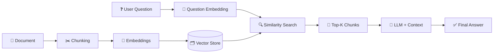

<!-- ===================== HEADER ===================== -->


<p align="center">
  <a href="https://git.io/typing-svg">
    
  </a>
</p>

<p align="center">
  <a href="mailto:shrirambarai46@gmail.com"></a>
  <a href="https://www.linkedin.com/in/shrirambarai/"></a>
  
</p>

---

## 🧑‍💻 About Me

<table>
<tr>
<td width="60%" valign="top">

```python
class ShriramBarai:
    role       = "Frontend Developer → GenAI Developer"
    experience = "5+ years total | 4+ years relevant"
    location   = "Mumbai, India 🇮🇳"

    frontend   = ["React", "Next.js", "TypeScript", "JavaScript"]
    backend    = ["Python", "FastAPI"]
    ai_focus   = ["LLMs", "Prompt Engineering", "Embeddings",
                  "RAG", "AI Agents", "Tool Calling"]

    def journey(self):
        return "API  →  RAG  →  Agents  →  Production 🚀"

    def goal(self):
        return "Scalable, production-ready AI applications"
```

</td>
<td width="40%" valign="top">

- ⚛️ Ship polished UIs with **React & Next.js**
- 🐍 Build AI backends with **Python & FastAPI**
- 📚 Built **RAG from scratch** — no LangChain
- 🛠️ Exploring **AI Agents & Tool Calling**
- 🎯 Aim: **production-grade GenAI products**

</td>
</tr>
</table>

---

## ⚡ Tech Stack

<p align="center"><b>🎨 Frontend</b></p>
<p align="center">
  
</p>

<p align="center"><b>🧠 Backend & AI</b></p>
<p align="center">
  
  &nbsp;
  
  
</p>

<p align="center"><b>🗄️ Database, Cloud & Tools</b></p>
<p align="center">
  
</p>

---

## 🤖 GenAI Skills

<p align="center">
  
  
  
  
  
  
  
  
  
  
</p>

---

## 🚀 Featured GenAI Projects

<table>
<tr>
<td width="50%" valign="top">

### 📝 AI Summarizer
AI-powered text summarization API.


- 🔌 LLM API integration
- ✍️ Prompt engineering
- ⚡ FastAPI REST + Swagger/OpenAPI docs
- 🔐 Env-based config for secrets

</td>
<td width="50%" valign="top">

### 📚 RAG + Embeddings (from scratch)
Full RAG pipeline built **without LangChain** to understand every step.


- ✂️ Document chunking
- 🔢 OpenAI embeddings + cosine similarity
- 🔍 Semantic search, Top-K retrieval
- 🧾 Source-aware LLM answers

</td>
</tr>
</table>

### 🔄 How my RAG pipeline works



---

## 🗺️ GenAI Roadmap

| Project | Status |
|:--|:--:|
| 📝 AI Summarizer | ✅ Done |
| 📚 RAG + Embeddings | ✅ Done |
| 📄 Chat with PDF | 🔄 In progress |
| 🛠️ AI Agents + Tools | 🔜 Up next |
| 🏭 Production GenAI App | 🔜 Planned |

---

## 📈 GitHub Stats

<p align="center">
  
  
</p>

<p align="center">
  
</p>

<p align="center">
  
</p>

---

## 💡 Currently Interested In

<p align="center">
  <b>Generative AI • LLM Applications • RAG • AI Agents • React • Next.js • Python • FastAPI • AI-powered Products</b>
</p>

---

## 🤝 Let's Connect

<p align="center">
  I'm open to <b>GenAI, Full-stack, Python and React</b> opportunities and collaborations.<br/>
  <a href="mailto:shrirambarai46@gmail.com"></a>
  <a href="https://www.linkedin.com/in/shrirambarai/"></a>
</p>


